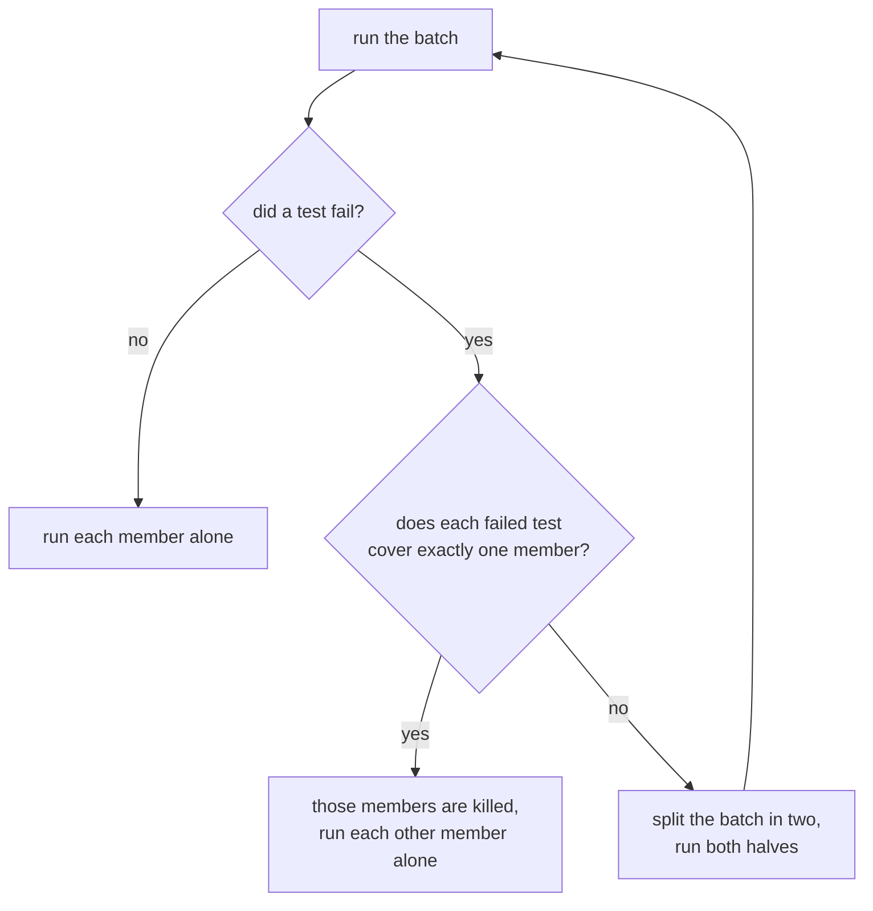

# Batch mutating

!!! abstract "Summary"
    Angelo puts some mutants into one test run. It groups only mutants that no test can
    reach together. Result: **4.6x faster**, with the same score.

## The problem

Standard mutation testing makes one mutant, runs the suite, records the verdict, and does
this again. Thus the cost is the number of mutants multiplied by the duration of one suite
run. 500 mutants on a 2-second suite take approximately 17 minutes. Most of that time is
Python startup, not testing.

A clear saving is to put more than one mutant in a run. The problem is then: which mutant
caused which test failure?

## Why simple combination fails

Polo, Piattini and García-Rodríguez (2009) combined mutants in pairs. This decreased the
number of runs by half. But they accepted a known cost, **fault masking**. When two mutants
are active in one execution, one mutant can hide the other. Then the verdict for at least
one of them is lost.

Angelo uses a different method. It does not accept masking. It makes masking impossible.

## The idea

Masking can occur only when one test executes both mutants. If no test executes both,
neither mutant can hide the other. Then each failure has one clear cause.

!!! note "Definition"
    Two mutants **conflict** when the same test case executes both of them. A **batch** is
    a set of mutants in which no two mutants conflict.

This rule is about **the tests**, not about the structure of the source code. Two mutants
in the same function or file can be in one batch, if no test reaches both. The tests are
the thing that Angelo measures, so the rule uses the tests.

## The source of the conflict data

Before it makes any mutant, Angelo runs your suite once with coverage.py and
`dynamic_context = test_function`. This records which lines ran, and also which test ran
each line.

The result is a map from each line to the set of tests that execute it. Two mutants
conflict when their sets have a test in common.

Angelo uses the same map for three more things:

| Use | Reason |
| --- | --- |
| A mutant on a line that no test executes survives without a run | No test can kill it. |
| A mutant that executes only during import runs alone | Import code executes under all tests. |
| Each run executes only the tests that reach its mutants | This is [test selection](02-test-selection.md). |

## How Angelo judges a batch

| Result of the batch | What Angelo does |
| --- | --- |
| A test failed, and it covers exactly one member | That member is killed. This gives the saving. |
| A timeout, a crash, or a failure that covers no member | Angelo does not guess. It splits the batch and runs the two halves. |
| A member has no failed test | Angelo runs that member alone before it records `survived`. |

**A batch can kill a mutant, but it cannot make a mutant survive.** A false survivor
reports a test gap that does not exist. Thus only a run with one mutant can record
`survived`.

## Result

200 mutants, 8 workers, 2-second suite.

| Batch size | Time | Score |
| --- | --- | --- |
| 1 | 48.1 s | 39.5% |
| 8 | 10.4 s | 39.5% |

**4.6x faster, with the same verdicts.** 161 runs became 21 runs.

!!! warning "On real projects, batch 8 can be slower"
    On flask, click, toolz and markupsafe on Windows, batch 1 is faster. See
    [benchmarks](05-benchmarks.md#batching-on-windows-measured-again).

## Limits

- Batching needs coverage.py and a `python -m pytest` test command. Without them, each
  batch has one member. Angelo still works.
- Angelo cannot batch mutants that run during import, because import code runs under all
  tests.
- Batching and [test selection](02-test-selection.md) compete for the same saving. Read
  that page before you change `batch_size`.
- A suite with much shared state gives failures that have no clear cause. Angelo then
  splits batches, and the saving decreases.
- On the [schemata](08-schemata.md) path, two mutants of the **same function** always
  conflict. One wrapper can call only one copy of the function.
- A `batch_size` larger than the default gives no improvement on a real project. flask's
  1000 mutants make 409 batches at size 8 and **407 at size 32**. The conflicts limit the
  batches, not the size.

!!! warning "A suite where the test order is important"
    A batch runs all the tests of all its members. If tests share state, a test can pass in
    a batch and fail alone. For this reason, each survivor always gets its own run. Angelo
    does not check a kill from a batch again, because that would remove most of the
    saving.

    Measure the noise before you blame batching. On flask, two identical batch-1 runs give
    different verdicts for **16 to 25 of 1000** mutants. Batch 8 and batch 1 give different
    verdicts for **26**. Most of these are kills in a batch that a run alone does not
    repeat. The
    [verdict matrix](https://github.com/kvandeh/angelo/blob/main/scripts/verdict-matrix.sh)
    makes sure that all configurations agree on a suite where the test order is not
    important.

## Related work

| Source | Relation |
| --- | --- |
| Untch, Offutt and Harrold (1993) | Mutant schemata, the classic cost decrease |
| Polo, Piattini and García-Rodríguez (2009) | Second-order mutants, and the masking problem that this page prevents |
| Ma and Kim (2016) | "Overlapped mutants" are almost-duplicate mutants. This is a different idea with a similar name. |
| mutest-rs | The same batching idea for Rust. It gets conflicts from a static call graph, not from coverage. |
