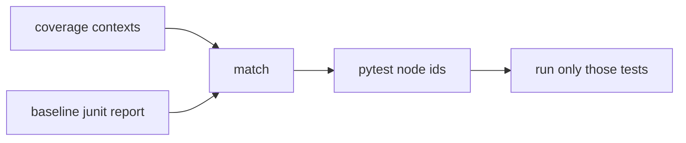
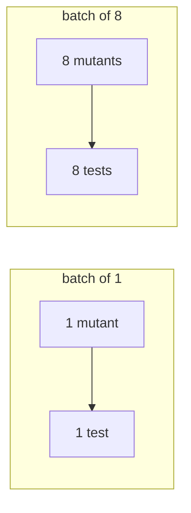

# Test selection

!!! abstract "Summary"
    Only a test that executes a mutant can detect it. Thus Angelo runs only those tests.
    Result: **2.8x faster** alone. It partly competes with batching.

## The problem

If you change one function and then run 3000 tests, most of that work is waste. Only the
few tests that execute that function can detect the change.

This is a known idea. PIT says that it changes the duration from days to minutes. Stryker
calls per-test coverage its largest speed setting.

Angelo already had the necessary data for [batching](01-batch-mutating.md). Test selection
uses the same data a second time.

## The difficult part

Coverage and pytest give a test different names.

| Source | Name of one test |
| --- | --- |
| coverage.py context | `pkg.test_mod.test_x` |
| pytest node id | `pkg/test_mod.py::test_x` |

A simple text conversion does not work, because a dotted name has more than one meaning.
`a.b.c` can be the module `a/b/c.py`. It can also be the module `a/b.py` with a class `c`.
The name does not tell you which.

Angelo tries each prefix of the name and uses the longest prefix that is a file on disk.
The list of tests comes from the junit report of the baseline run. That report gives each
test with its class name.

**The two names also start at different points.** coverage.py uses the `__name__` of the
test module. junit uses the path from the pytest root directory. The two names are the same
only when the test directory is a Python package. Most pytest projects have no
`tests/__init__.py`. Thus `tests/test_app.py` has the module name `test_app`:

| Source | flask |
| --- | --- |
| coverage.py context | `test_appctx.test_basic_url_generation` |
| junit `classname.name` | `tests.test_appctx.test_basic_url_generation` |

An exact match found **0 of the 371 flask contexts**. Each run then used the full suite, and
test selection did nothing. There was no error. The results were correct, but eight times
slower.

Now Angelo removes the first parts of the name, one at a time, until a part matches. If two
junit tests match the same name, Angelo **does not use the name**. One node id for two tests
would run too few tests, and too few tests can make a false survivor.

## Two safety rules

**If Angelo cannot find a test name, it runs the full suite.** When Angelo cannot name one
of the covering tests exactly, it runs all tests for that batch. Too many tests cost time.
Too few tests can make false survivors. This tool must not make false survivors.

**A run with one mutant stops at the first failure.** When one test fails, that mutant is
killed. The other tests cannot change that verdict. A batch does not stop early, because it
must see all failures to find which member each one belongs to.

This rule also applies when a single-mutant run uses the full suite. Before this was
corrected, a mutant that ran during import executed all 371 flask tests after the first
failure. Some of these runs went past the time limit, and Angelo recorded `timeout`, not
`killed`. **23 of 1000 mutants had the wrong status.**

## The time limit follows the selection

A run that selects its tests also gets its time limit from those tests.

| Run | Time limit |
| --- | --- |
| Selected tests | baseline time of those tests × `timeout_factor` + 5 s |
| Full suite | duration of the suite × `timeout_factor` + 5 s |

The junit report of the baseline run gives a `time` for each test. Thus the data costs
nothing.

**This saving is large.** A timeout uses all of its time limit each time. On click, a
4.21-second suite gave each mutant approximately 22 seconds. Mutants whose tests take only
50 milliseconds got the same limit. Each run had 60 to 76 such timeouts. In that
measurement, batching and test selection
[gave no improvement](05-benchmarks.md#a-real-codebase-where-the-numbers-do-not-hold).

**The minimum of 5 seconds is a constant, on purpose.** Interpreter startup, imports and
collection are most of a short run, and junit `time` does not include them. If the extra
time increased with the test time, the fastest tests would get the least extra time. That
is wrong. 5 seconds is enough for a cold start on a busy computer. This is necessary,
because when a warm worker fails, Angelo uses a cold subprocess.

## Which error is worse

A time limit that is too long wastes time. A time limit that is too short **makes false
kills**, because a timeout counts as detected. A false kill is worse, so both parts of the
time limit are generous.

**A timeout gets a second run.** When a mutant times out alone, Angelo runs it again with
two times the time limit. Only a second timeout counts as detected.

One limit remains. A mutant that makes the code slower, but does not make it hang, can now
go past a shorter limit than before. Such a mutant then counts as detected, but before it
survived. The
[verdict matrix](https://github.com/kvandeh/angelo/blob/main/scripts/verdict-matrix.sh)
contains a mutant that hangs on purpose. If a configuration does not agree about a
timeout, the build fails.

## Result

200 mutants, 8 workers.

| Suite duration | Batching alone | Selection alone | Both |
| --- | --- | --- | --- |
| 2.0 s | 4.6x | **2.8x** | **7.7x** |
| 0.2 s | 3.7x | 1.05x | 4.0x |

## How selection and batching interact

At batch size 1, selection gives 2.8x. At batch size 8, it gives only 1.7x.

A batch runs all the covering tests of all its members. A larger batch runs more tests, so
it is nearer to the full suite. The two features compete for the same saving.

Together they give 7.7x. This is much less than 12.9x, the product of the two. We know of
no published number for this interaction. Thus we recommend that you measure `batch_size`
on your own project. Do not trust the default without a measurement.

## Limits

- Selection removes **test** time. It does not remove **startup** time. A fast suite has
  little test time to remove. Thus the 0.2-second row shows almost no improvement.
  [Warm workers](03-warm-workers.md) decrease the startup time.
- Angelo selects a parametrised test as one function. Thus the selection can contain more
  cases than necessary. This is safe.
- Test selection needs coverage.py and a `python -m pytest` test command.
