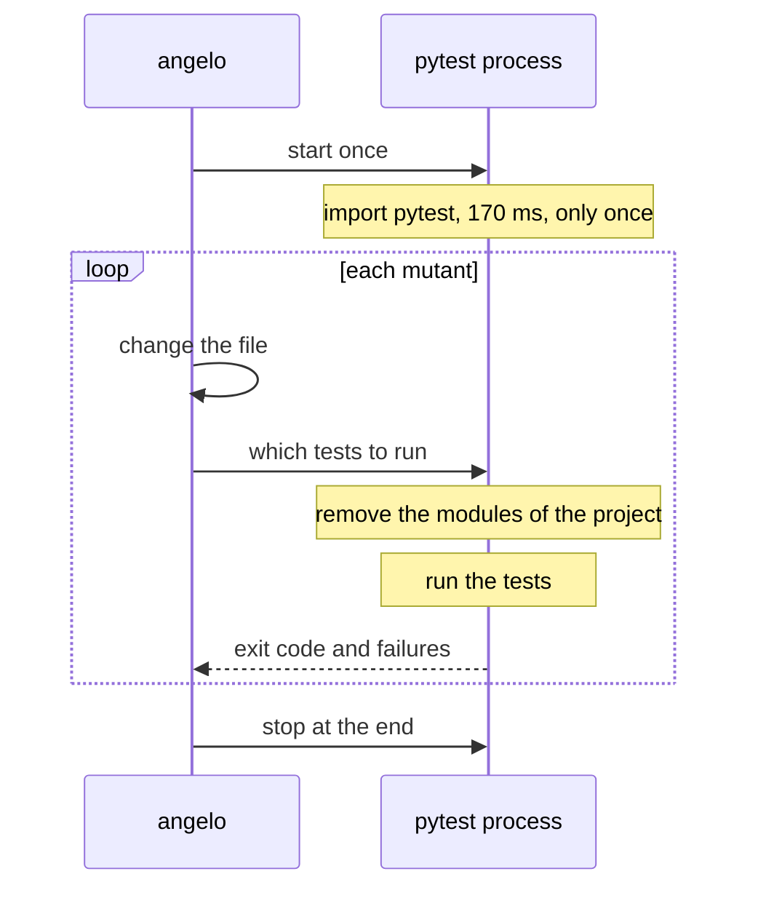

# Warm workers

!!! abstract "Summary"
    After test selection, most of the remaining time is Python startup. Unix tools use
    `fork()` to prevent this. Windows has no `fork()`. Thus Angelo keeps one pytest process
    alive. Result: **2.5x faster**, with the same verdicts.

## The problem

After [test selection](02-test-selection.md), one mutant takes approximately 330
milliseconds. Only approximately 15 milliseconds of that is testing.

| Step | Time |
| --- | --- |
| Start the interpreter | 18 ms |
| Import pytest | 155 ms |
| Collect and configure | 139 ms |
| Run the test | 15 ms |
| **Total** | **327 ms** |

Approximately 95% of a run is setup, and setup gives no information. Better scheduling
cannot help, because this cost occurs before the test starts.

## How other tools prevent it

`fork()` makes a copy of a running process almost immediately. The copy has all the modules
that the parent imported. Thus a mutation tool can import pytest once and then make a fork
for each mutant. Each copy starts with pytest loaded. When it stops, all its changes stop
with it.

For this reason, mutmut is fast. For the same reason, mutmut **does not run on Windows**.
It tells you to use WSL, because Windows has no `fork()`.

## An alternative that we rejected

Python 3.14 added `concurrent.interpreters` (PEP 734). Subinterpreters are isolated and
fast to create, and they work on Windows. Thus they looked like a good replacement.

We measured them:

| Step | Time |
| --- | --- |
| Create a subinterpreter | 15 ms |
| Import pytest in it | **131 ms** |
| Import pytest cold, in the main interpreter | 119 ms |

**There is no saving.** Each subinterpreter has its own `sys.modules`, so it must import
everything again. The value of `fork()` is that the copy keeps the imports. PEP 734 does
not do this, on purpose.

We record this result so that nobody does the experiment again.

## What Angelo does

Angelo keeps the process alive. It resets only the parts that changed.

Between two mutants, the worker removes each module whose file is in the project copy.
Thus Python imports the changed source again on the next run. pytest, the standard library
and site-packages stay loaded. This gives all of the saving.

## Safety

A process that stays alive can collect state, and state can cause wrong verdicts. Thus
these rules apply.

**A problem stops the worker.** If the process crashes, or if Angelo cannot read its reply,
Angelo stops the process. It then runs the mutant again in a new subprocess. Thus warm
workers can change the duration, but not the verdict.

A timeout stops a **purging** worker, because that worker is still in the test that hung. A
timeout does not stop a [forking](08-schemata.md#isolation) worker. That parent did not run
the test. It stopped the process group of the child and continued. A restart would repeat
a warm-up that has no problems.

**Angelo checks each `error` again in a new process.** A mutant can change the standard
library, and the module removal cannot undo that change. Before each run, the worker also
resets the working directory, the environment variables and the standard streams.

**The process restarts.** After `warm_recycle_after` runs (default 50), Angelo replaces the
process. This limits any state that the module removal does not remove. On the fork path,
this setting has no effect, because no state collects there.

**Warm workers apply only to `python -m pytest` commands.** Other commands use
subprocesses.

## Result

200 mutants, 8 workers.

| Configuration | Warm off | Warm on | Improvement |
| --- | --- | --- | --- |
| 0.2 s suite, batch 1 | 9.29 s | **3.77 s** | 2.5x |
| 2.0 s suite, batch 1 | 11.20 s | **5.94 s** | 1.9x |
| 2.0 s suite, batch 8 | 5.12 s | 4.45 s | 1.15x |

Warm workers give the most improvement when there are many short runs. Test selection is
the opposite. With batching and test selection, a 48.1-second job takes 4.5 seconds.

## Four bugs that warm workers caused

None of the four bugs gave an error message. Tests found the first two. Real projects found
the last two.

**The removal of `__main__` broke pytest.** The worker script is `__main__`, and it is in
the project copy. Thus the module removal deleted it. The Python debugger imports
`__main__`, so each mutant got the status `error`.

**The pytest output mixed with the protocol.** Both wrote to the same stdout. Thus the
reader read "1 passed" as a reply. Now each reply starts with a marker.

**A parametrised test hid the failures after it.** The reader stopped the list of failed
tests at the first `]`. A name such as `test_x[a-1]` contains one. In a batch, Angelo lost
each later failure and recorded `survived` for its mutant.

| Project, 1000 mutants | False survivors at batch 8 |
| --- | --- |
| flask | 113 |
| click | 106 |
| markupsafe | 46 |

**State from one mutant caused an `error` for others.** On click, 44 of 1000 verdicts were
`error` with warm workers on, and none with warm workers off. One mutant in that sample
removes the line that resets `pdb.Pdb.__init__`. The module removal cannot undo this. Now a
new process checks each `error`.

## Limits

- Warm workers apply only to `python -m pytest` commands.
- Some state can stay after the module removal. Examples: global variables in C extensions,
  and third-party caches that keep project objects. The restart limits this risk. It does
  not remove it.
- On the purge path, a mutant that hangs causes a restart of the worker, not only a stop of
  one process.
- **If a score changes between identical runs, first set `warm_workers = false`.** This is
  the same type of risk as the old-bytecode bug in [benchmarks](05-benchmarks.md).
