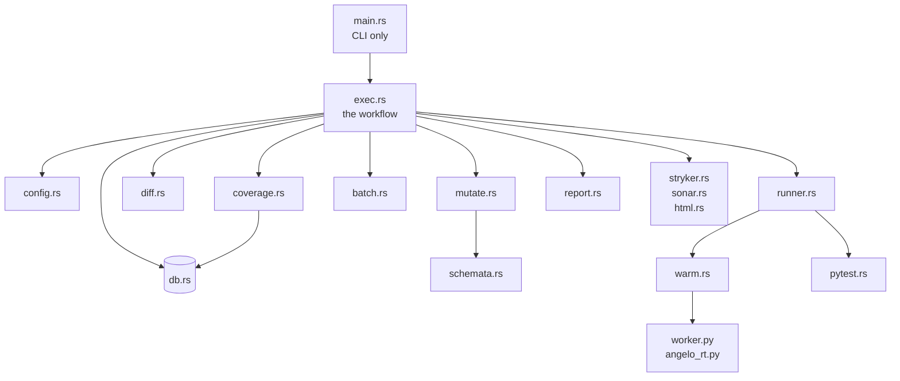
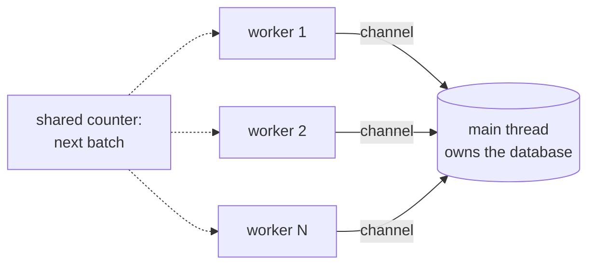

# Architecture

!!! abstract "Summary"
    One Rust binary, flat modules, two Python files. Each type owns its behaviour. Only one
    file is async. Each type that needs cleanup does its own cleanup.

The crate has approximately 9,000 lines of Rust. Approximately one third of them are unit
tests. There are also two Python files (approximately 280 lines) and thirteen
dependencies.

The crate is in the `Angelo/` directory, not in the repository root. The other directories
are not part of the tool:

| Directory | Contents |
| --- | --- |
| `Angelo/` | The crate: `src/`, `tests/`, `Cargo.toml` |
| `docs/` | This documentation |
| `demo/` | A pytest project for manual runs |
| `integrations/` | How Angelo goes to other systems: the PyPI wheel and the SonarQube plugin |
| `scripts/` | Tools for development only. They are not in the binary or the wheel. |

## Module map

| Module | Owns |
| --- | --- |
| `main.rs` | The command-line definitions and dispatch. Nothing else. |
| `exec.rs` | The workflow: enumerate, baseline, split, compose, run, report. |
| `config.rs` | `angelo.conf`, file discovery, skip lists, `exclude` patterns. |
| `mutate.rs` | `Mutant`, `Status`, the operator table, enumeration. |
| `schemata.rs` | All mutants of a file, compiled into the file at once. |
| `coverage.rs` | `Coverage`: classify, attribute, select. |
| `batch.rs` | `Batch`: the conflict rules and the composer. |
| `diff.rs` | `Scope` and `ChangedLines`: from git hunks to a line filter. |
| `pytest.rs` | The pytest process, `SuiteResult`, `Selection`, `Budget`, node ids. |
| `runner.rs` | Threads, project copies, patches, batch splits. |
| `warm.rs` | The pytest process that stays alive, with its fork and purge paths. |
| `db.rs` | turso. **The only async file.** |
| `report.rs` | `Progress` (the bars), `Diagnostics`, `Summary` (the score), `Gate` (`--fail-under`). |
| `logging.rs` | `Verbosity`, the priority rule for log levels, and the log output. |
| `stryker.rs` | The mutation-testing-report JSON. |
| `sonar.rs` | The SonarQube generic issue JSON. |
| `html.rs` | The self-contained HTML report. |

## Three rules

### Each type owns its behaviour

If a function takes an `X` and makes a decision from it, the function belongs on `X`. Thus
the code has `SuiteResult::status()`, `Batch::accepts()` and `TestCase::node_id()`. It does
not have many free functions with six arguments each.

### Only one file is async

The turso API is only async. `db.rs` has one single-threaded tokio runtime and waits on each
call. Thus async does not spread through the program. All code outside that file is
ordinary synchronous Rust.

### Cleanup is automatic

Each type that must undo a change implements `Drop`. Thus Rust undoes the change also after
an early return or a panic.

| Type | Undoes |
| --- | --- |
| `WorkerCopy` | Deletes the temporary copy of the project |
| `PatchedFiles` | Restores the original files |
| `WarmWorker` | Stops the pytest process |

`Drop` cannot return an error. Thus `PatchedFiles` ignores a failed restore, on purpose.
Before the next batch changes a file, it checks the original bytes. Thus a failed restore
gives an `error` verdict, not a wrong verdict.

## Concurrency

Angelo uses scoped threads, one atomic integer as the work queue, and a channel for the
results. **Only the main thread writes to the database.** Thus the program needs no locks.

Scoped threads also let a worker use plain references. The compiler can prove that the
threads stop before the borrowed data goes away. Thus the code needs no reference-counted
pointers.

## Data is in data files

| File | Reason |
| --- | --- |
| `db/schema.sql` | SQL must be in an SQL file, not in a string constant. |
| `runner/worker.py`, `runner/angelo_rt.py` | Python must be in a Python file, where an editor can check it. |
| `html/template.html` | HTML must be in an HTML file. |

The compiler puts these files into the binary. Thus there is still only one file to
install.

The operator table is a macro. Thus the lookup and the list for its tests come from the same
lines, and they cannot become different.

## Dependencies

| Group | Crates |
| --- | --- |
| Basic functions | clap, serde, toml, anyhow |
| Database | turso, tokio |
| Python parser | ruff_python_parser, ruff_python_ast, ruff_text_size |
| junit XML | roxmltree |
| Log output | log, env_logger |
| Progress bars | indicatif |

Each new dependency must have a reason. We removed three and wrote small replacements:

| Removed | Replacement |
| --- | --- |
| `walkdir` | A recursive copy of twelve lines |
| `tempfile` | A `Drop` implementation |
| `serde_json` | A list with one item on each line, a small reply parser, and one escape function for the two JSON reports |
