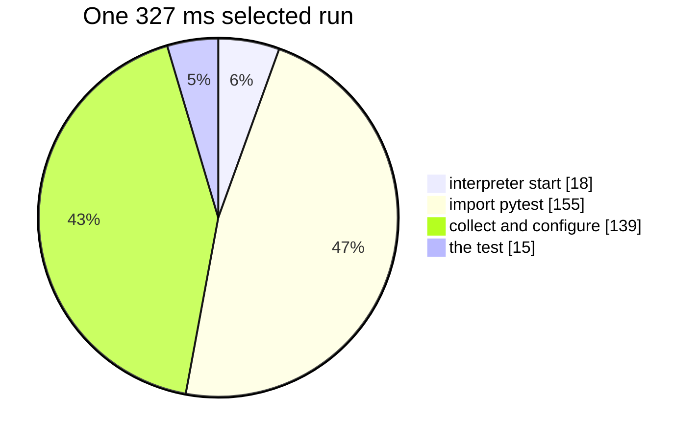
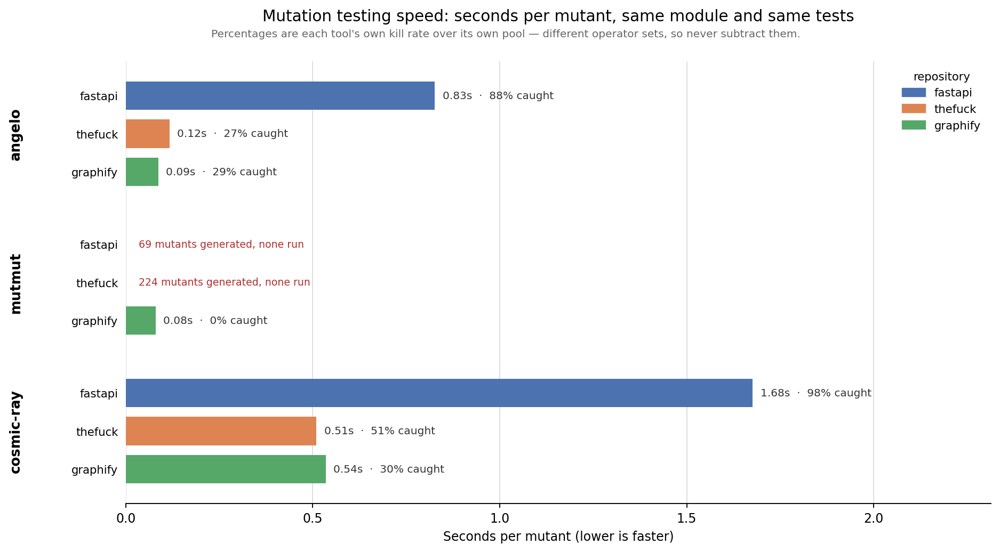

# Benchmarks

!!! abstract "Summary"
    With all optimisations, a 48-second job takes 4.5 seconds, and the verdicts do not
    change. This page gives the measurements and the comparison with mutmut and
    cosmic-ray. It also records one bug that made earlier numbers false, and optimisations
    that gave no improvement.

## Method

- **Computer.** WSL Ubuntu on Windows 11, 16 cores, Python 3.14.
- **Synthetic project.** 40 independent functions, one test for each, 200 mutants. A
  `sleep` in `conftest.py` sets the duration of the suite. Thus we can measure the same
  mutants with a fast suite and a slow suite.
- **Control.** The score. All configurations must give the same score.
- Each number is from one run, not an average. A difference of less than approximately 10%
  is noise.

## The feature matrix

200 mutants, 8 workers.

| Suite | Batch | Selection | Warm | Time | Score |
| --- | --- | --- | --- | --- | --- |
| 0.2 s | 1 | off | off | 15.88 s | 39.5% |
| 0.2 s | 8 | on | off | 3.99 s | 39.5% |
| 0.2 s | 8 | on | on | **2.16 s** | 39.5% |
| 2.0 s | 1 | off | off | 48.13 s | 39.5% |
| 2.0 s | 8 | on | off | 6.22 s | 39.5% |
| 2.0 s | 8 | on | on | **4.45 s** | 39.5% |

**10.8x faster on the slow suite, 7.4x on the fast suite.** The score did not change.

## Where the time of a run goes

One run of one selected test. We measured each step separately:



Approximately 95% is setup. For this reason, [warm workers](03-warm-workers.md) exist, and
[test selection](02-test-selection.md) alone has a limit.

## Which feature helps when

| Feature | Fast suite | Slow suite |
| --- | --- | --- |
| Batching | 3.7x | 4.6x |
| Test selection | 1.05x | 2.8x |
| Warm workers | 2.5x | 1.9x |

The general rule: **test selection removes test time. Warm workers remove startup time.** A
project with a slow suite gets more from test selection. A project with many fast tests
gets more from warm workers. Batching helps both, but it partly competes with test
selection.

## A real codebase, where the numbers do not hold

The synthetic result is not true for click. 957 mutants, a 4.21-second suite, 8 workers.

| Batch | Selection | Warm | Time | Per mutant | Detected | Survived |
| --- | --- | --- | --- | --- | --- | --- |
| 1 | off | off | 1119 s | 1.170 s | 540 | 336 |
| 1 | on | off | 1189 s | 1.242 s | 540 | 336 |
| 8 | on | off | 1130 s | 1.181 s | 541 | 335 |

**The optimisations gave almost no improvement. Test selection was a little slower than no
selection.** All configurations take approximately 1.2 seconds for each mutant.

The verdicts show the probable cause. In each run, 60 to 76 mutants **time out**. A timeout
uses all of its time limit, here approximately 22 seconds. Batching and test selection
cannot make a timeout shorter. On click, the wait for timeouts is larger than all the
savings.

The synthetic project has no timeouts. For this reason, it showed 10.8x.

!!! note "The time limit was the problem, and it has changed"
    The 22 seconds came from the duration of the **full suite**. Each mutant got this
    limit, also mutants whose selected tests take 50 milliseconds. Now the time limit comes
    from [the tests that the run executes](02-test-selection.md#the-time-limit-follows-the-selection).
    **The three rows above are from before that change. We did not measure them again.**
    Until we run click again on the same computer, use this table as the last correct
    measurement, not as the current result.

!!! warning "The synthetic numbers are a best case"
    Independent functions, separate tests and no timeouts are the best case for all
    techniques in this tool. A real project with slow or hanging mutants can get no
    speed-up.

### Why the verdicts changed a little

The three rows do not agree: 540, 540 and 541 detected; 336, 336 and 335 survived.

The cause is **timeout classification**, not a batching error. `timeout_factor` uses clock
time. Thus a mutant near the time limit times out on a busy computer and survives on an
idle computer. For the same reason, the killed and timeout counts change between runs.

The [verdict matrix](https://github.com/kvandeh/angelo/blob/main/scripts/verdict-matrix.sh)
in CI used a project with no timeouts. Thus it could not find this type of change. Now the
project contains one mutant that never stops, and all configurations must agree that it
timed out. Each configuration selects different tests, so each gets a different time limit.
The matrix must detect a disagreement that this causes.

### A fourth row that we did not use

We measured a fourth configuration. But during that measurement, the list of operators got
larger. Thus it made 4596 mutants, not 957. We do not show it, because it compares two
different tools.

### flask

We measured flask and found four bugs. A sample of 1000 mutants, 16 workers, a Ryzen 7 5800
(**8 physical cores**, 16 threads). The time includes enumeration.

| Fix | Total time |
| --- | --- |
| None | 718 s |
| Coverage contexts now match, so [selection](02-test-selection.md) works | 326 s |
| A batch that timed out runs each member once, and does not split. A forking worker continues after a timeout. | 125 s |
| Enumeration commits once, not 2541 times | 122 s |
| A single mutant gets `-x` also when it runs the full suite | **120 s** |

**Six times faster, and schemata did not cause any of it.** The first fix is the most
important. On a project with no `tests/__init__.py`, *no* coverage context matched a node
id. Thus each run executed the full suite, and there was no error. This problem hid all the
others.

The last fix is not only a speed-up. **23 of 1000 mutants had the status `timeout`, but the
correct status was `killed`.** A test detected them early, but the run continued until it
went past the time limit. The score did not change (a timeout counts as detected), but the
report gave the wrong cause.

#### Where the remaining time goes, and why this is a minimum

At 16 workers, **87% of all the work is full-suite runs**. There are only approximately 240
of them:

| | Runs | Part of the work |
| --- | --- | --- |
| Mutants that run during import, full suite | ~240 | 87% |
| All other runs | ~520 | 13% |

A mutant that runs during import is in a module body, a class attribute or a decorator.
That code runs under **all** tests. Thus coverage cannot decrease the number of tests, and
no batch can contain two such mutants. Each one needs a full 1.2-second run of the flask
suite: 240 × 1.2 = **294 core-seconds**. This time is the measurement itself, not overhead.

More workers do not help, because the computer is at its limit:

| Workers | Total time | Worker-seconds | Concurrency |
| --- | --- | --- | --- |
| 4 | 271.8 s | 1063 | 3.9x |
| 8 | 182.9 s | 1403 | 7.7x |
| 16 | 173.4 s | 2595 | 15.0x |

Angelo uses almost all of each level. But **8 → 16 workers gives only 5%**, because the
computer has eight physical cores. The second thread on each core shares that core. To
test a 1000-mutant flask sample in less than one minute, Angelo would have to stop the
mutation of import code. The schemata design of mutmut does this. But then the score
measures a different thing.

## Against mutmut and cosmic-ray

WSL Ubuntu, 16 cores, Python 3.12, 12 workers. Each tool mutates **one module** and runs
**the same tests**, in the virtual environment of the repository. Thus the job is the same.
`scripts/benchmark.py` made these results.

**Compare only the seconds for each mutant.** The tools have different operators, so they
make different mutants. Thus the total time compares two different jobs. Each score is the
kill rate of one tool on its own mutants. We show the scores next to each other, but do not
compare them.

| Repository | Module | Angelo | mutmut | cosmic-ray |
| --- | --- | ---: | ---: | ---: |
| fastapi | `fastapi/security/api_key.py` | **0.827 s** | did not run | 1.677 s |
| thefuck | `thefuck/types.py` | **0.117 s** | did not run | 0.510 s |
| graphify | `graphify/cluster.py` | **0.087 s** | 0.080 s | 0.535 s |

**Angelo is 2.0x to 4.4x faster for each mutant than cosmic-ray.** It is equal to mutmut on
the one repository where mutmut runs.



### What the other two tools did

**cosmic-ray runs one mutant at a time.** With `worker-count = 12` and its `local`
distributor, it ran only one pytest process at a time. This causes most of the difference
above. Thus the column measures the default of cosmic-ray, not its maximum speed. Its
fastapi row is a **timeout**: 179 of 183 mutants in a 300-second limit. We counted these
from its session database. We did not remove them.

**mutmut ran on one of three repositories.** On fastapi and thefuck, it makes its mutants
and then stops at its own check, `Unable to force test failures`. It runs no mutants. A
control run on **markupsafe** completes 314 mutants in 5.9 s. Thus the problem is in mutmut
on these repositories, not in our setup. We show both results. **A tool that gives no
verdicts must not look fast.**

### What this does not prove

- One module for each repository, not a full codebase. A different module changes all the
  numbers.
- One run each. `benchmark.py --repeats 3 --warmup` gives a median. We did not use it here.
- The graphify score of mutmut is 0.4%, and the score of Angelo is 29.0%, on the same
  module. These are two different sets of mutants. This is not a quality comparison. For
  this reason, the rule above exists.

## The allocation pass

Nobody had examined the memory allocations in the Rust code of Angelo. We fixed four
patterns:

- A line counter that read a file again from byte zero for each mutant
- A `String` copy for each covered line in the coverage map
- A copy of a `HashSet` for each classification
- A full copy of the file for each batch member

We added no dependency, and no mutant changed.

We measured on a shallow clone of django: 523,660 lines in 2,927 files. Angelo makes
**89,303 mutants in 908 files** from it. Windows 11, release build, three runs each.
`exec --diff` on a clean tree isolates the enumeration: it parses and enumerates all files,
but it inserts nothing.

| Phase | Before | After |
| --- | --- | --- |
| Enumeration alone | 1.63 s | **1.26 s** |
| Enumeration and the database insert | 150.4 s | 147.3 s |

**Enumeration became 1.3x faster, but this was not important.** The insert of 89,303 rows
takes approximately 148 seconds. Thus the saving of 0.37 seconds is 0.25% of the command.
On the demo project, with 30 mutants, we cannot measure it.

This result shows the next problem. The row insert makes `angelo exec` slow to start on a
large codebase. We did not change it here, because this was an allocation pass. (Later, a
single transaction for all rows fixed most of it. See the flask table above.)

The other two fixes are on the run path. There, each saving is very small compared with a
pytest process of 300 milliseconds. We did not expect a speed-up there, and we did not
measure one. These fixes had to prove that they change no verdict. The
[verdict matrix](https://github.com/kvandeh/angelo/blob/main/scripts/verdict-matrix.sh)
proves this.

!!! note "Two recommendations that do not apply"
    **rayon.** `TestRunner::run_all` already uses all cores with `std::thread::scope` and an
    atomic work index. Each work item is a subprocess, not a calculation. A dependency
    that repeats the standard library has a cost and no benefit.

    **`swap_remove`.** The codebase has no `Vec::remove` that must keep the order. Thus
    there is nothing to replace.

## Comparison with mutmut

The same computer and the same project. Both use 8 workers.

| Tool | Mutants | Total time | Per mutant |
| --- | --- | --- | --- |
| Angelo, batch 16 | 200 | 2.5 s | 0.0125 s |
| mutmut 3.6.0 | 360 | 3.7 s | **0.0103 s** |

**mutmut is approximately 1.2x faster for each mutant.** It uses schemata and `fork()`.
Angelo, without either, is almost as fast. The operator sets are different, so only the
time for each mutant is a fair comparison.

mutmut **cannot run on Windows**, because it needs `fork()`.

## The bug that made earlier numbers false

Four configurations must agree. They reported **77, 73, 69 and 78** kills.

Python uses a `.pyc` file again when two values of the source file do not change. These
values are the modification time in whole seconds and the size in bytes. A mutant of the same size, for
example `+` to `-`, written in the same second as the previous mutant, thus ran the **old
bytecode**. The mutant survived, but no test had a chance to kill it.

- On Windows, a 1.9-second suite puts the writes in different seconds. Thus the bug was not
  visible.
- On Linux, a 0.2-second suite puts many runs in one second. Thus the bug was clear.
- The fix: Python never writes bytecode. The environment variable alone is **not**
  sufficient if a `.pyc` exists, because Python still reads it.

The characteristic failure of a mutation tool is to report test gaps that do not exist. The
verdict matrix in CI exists because of this bug.

## Batching on Windows, measured again

The same 1000 mutants for each repository, 8 workers, warm workers on. Each survivor gets
its own run.

| Repository | Batch 1 | Batch 8 |
| --- | --- | --- |
| flask | **189 s** | 292 s |
| click | **210 s** | 263 s |
| toolz | **104 s** | 127 s |
| markupsafe | **32 s** | 44 s |

**Batch 1 is faster on all four.** It was also faster before the survivor check: flask took
167 s at batch 1 and 239 s at batch 8. The 4.6x improvement in
[batch mutating](01-batch-mutating.md) comes from a small synthetic suite. Do not expect it
on a real repository until we solve this.

## What these numbers do not prove

- The synthetic project has **independent functions with separate tests**. This is the
  best possible case for batching. Real code shares tests, so expect less.
- One run on one computer, with no confidence intervals.
- On Windows, a new process takes much more time than on Linux. Compare results only on the
  same platform.
- A tool that fails immediately on each mutant looks fast and gives a score of zero.
  **Look at the error count before you trust a score.**

## Reproduce the results

```bash
bash scripts/verdict-matrix.sh          # the correctness check, runs in CI
bash scripts/setup-extra.sh             # one virtual environment for each repository in extra/
bash scripts/bench-repo.sh extra/click  # the feature matrix on a real project

pip install -r scripts/requirements-bench.txt
python scripts/benchmark.py --root extra --angelo Angelo/target/release/angelo
```

`scripts/benchmark.py` is the comparison of the three tools. One command writes
`bench-results.md`, `bench-results.json` and `bench-results.png`.

```bash
python scripts/benchmark.py --tools angelo,cosmic-ray   # skip a tool
python scripts/benchmark.py --repeats 3 --warmup        # median of three
```

**mutmut needs `fork()`, so that script works only on Linux and macOS.** On Windows, it
stops. It does not print half a table.

`extra/` contains shallow clones of click, flask, httpx, requests, fastapi and django. Git
ignores them.

**Each repository needs its own virtual environment.** Real projects name pytest plugins in
`pyproject.toml`. With a global Python, pytest exits with code 3 (an internal error) before
it collects any test. Angelo then stops, which is correct. The fix is to install the
dependencies, not to change Angelo.

**Angelo cannot mutate django**, because django uses its own test runner, not pytest.
