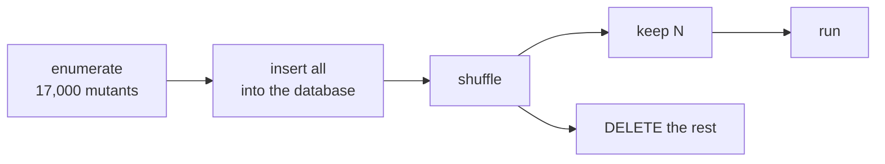

# Operators and sampling

!!! abstract "Summary"
    Research decides the operators of Angelo. The ease of the implementation does not.
    Three families have support from all measurements: **statement deletion**,
    **relational replacement**, and **conditional and logical replacement**. Three standard
    families have support from none, and they are **off by default**. The location of a
    mutant is more important than its operator. Thus `arid` stops mutants in code that
    gives no useful results, and `per_line_cap` limits the mutants on one line.
    `--sample N` limits the total by **deleting rows**. The score is then an estimate.

## Background: the measurements do not agree, and that is correct

Thirty years of research on operator selection looks contradictory. One study says that
five operators are sufficient. A different study says 28. A third says that statement
deletion alone is as good as all of them. A fourth says that operator selection is not
better than a random choice of mutants. These studies answer **different questions**:

| Measurement | Question |
| --- | --- |
| Sufficiency | Do tests that kill the mutants of a subset also kill the mutants of the full set? |
| Coupling to real faults | Are the mutants of an operator similar to faults that developers fixed? |
| Equivalent and stubborn mutants | How many mutants have the same behaviour as the original? These are only cost. |
| Productivity, judged by developers | When an engineer sees a survivor in their code, do they think that it needs a test? |

Only the last measurement exists at industrial scale. Only the second measures the purpose
of mutants. Together, they give a clear ranking. The default set of Angelo follows that
ranking.

## Method: the tiers, and what Angelo does with each

| Tier | Family | Angelo |
| --- | --- | --- |
| **Always on** | Statement and block deletion | `BlockStatement`, on |
| | Relational replacement | `EqualityOperator`, on, two replacements for each ordering operator |
| | Conditional and logical replacement | `ConditionalExpression` and `LogicalOperator`, on |
| **On, without duplicates** | Arithmetic replacement | `ArithmeticOperator`, `AssignmentOperator`, `BitwiseOperator`, on |
| **Only with local evidence** | Unary insertion | `UnaryOperator`, **off** |
| | Constant and literal replacement | `NumberLiteral`, `StringLiteral`, **off** |
| **Never** | Type, declaration and modifier mutations | not implemented |

The last row is not only a caution for Python. A compiler for a statically typed language
detects those mutants, so their cost is small. A dynamically typed language finds them only
when the code runs. Python already has the lowest productivity, judged by developers, of the
languages measured at scale: **70.6%, against 87.2% for Java**. For the same reason, a mutant
with an invalid type gets the status `error`, and it is **not in** the score.

### Statement deletion

This family has the best cost-effectiveness evidence in the research. It is not in the
standard set of five operators. It gives a score near the score of that set, with
approximately **80% fewer mutants**. It is one of the families that most often matches real
faults. Even the strongest study against selective mutation finds it **nearer to the Pareto
front** of score against work than the standard five.

Angelo replaces a statement with `pass`. Thus a block that loses its only statement is
still a block:

```python
def total(items):
    running = 0
    for item in items:
        running += item.price      # -> pass
    return running                 # -> pass
```

Angelo also deletes a full block. Thus it also replaces the full `for` loop above.

Deletion shows the problem that coverage cannot see: **a line that runs, but no test checks
it**. To detect a deletion, a test must contain an assertion. Execution alone is not
sufficient.

Angelo never deletes these statements, because the mutant is either always detected or
never detected:

- **Imports and definitions.** All uses of the name fail. Thus each test that touches the
  module kills the mutant immediately, and the mutant gives no information.
- **A `return` with no value.** The function returns `None` without it. Thus the deletion
  makes an equivalent mutant.
- **Docstrings, `...` stubs and literals alone on a line.** The same reason.

### Condition replacement

```python
if user.is_admin and not expired:   # -> if True:   /   if False:
while pending:                      # -> while False:
```

Only the syntax tree knows where a condition starts and stops. Thus this is the second
operator that a token stream cannot make. A `while` gets **only `False`**. `while True` on a
loop that stopped before now never stops. A timeout counts as detected. Thus that mutant
would use the full time limit to report what `False` reports in milliseconds.

Angelo does not change a condition that is already a constant. A deliberate `while True:`
is not a fault.

### Relational replacement, two times

Relational replacement is the only operator with good results in **all** measurements. It
is in the classic sufficient set. It is one of the families that most often matches real
faults. Its median coupling is two times the median of all operators. Of the five operators
that Google uses, it has the highest productivity, judged by developers: **84.1%**.

A relational condition permits seven mutants. Three of them include the other four. Thus
all seven are waste. Angelo made only **one**, which is less than three. It made only the
negation, and nothing tested the boundary, where off-by-one faults occur. Now each ordering
operator gets two replacements.

| Original | Boundary | Negation |
| --- | --- | --- |
| `<` | `<=` | `>=` |
| `<=` | `<` | `>` |
| `>` | `>=` | `<=` |
| `>=` | `>` | `<` |

Equality has no boundary, so `==` and `!=` keep one replacement.

### The families that are off

`UnaryOperator` is unary operator insertion. Google measured five operators over **16.9
million mutants**. Of those five, this operator has the lowest survival rate (9.6%, against
12.5% for all) and the lowest productivity, judged by developers (74.5%). Existing tests
most often kill its mutants. When its mutants survive, developers least often think that
they need a test.

`NumberLiteral` and `StringLiteral` are constant replacement. A regression study of 108
operators selected 28, and **no constant operator**. Constant operators make many almost
identical mutants. Also, they cannot make the fault that they seem to model. A real literal
fault is one specific wrong value, for example a specific key or character. An operator
cannot guess it.

To use one of these families, add one line to `angelo.conf`:

```toml
operators = [
    "ArithmeticOperator", "AssignmentOperator", "BitwiseOperator",
    "BlockStatement", "BooleanLiteral", "ConditionalExpression",
    "EqualityOperator", "LogicalOperator", "MethodExpression",
    "StatementSwap",
    "StringLiteral",           # this project's faults live in its literals
]
```

If Angelo does not know a name, **the run stops**. If Angelo ignored the name, it would
disable a full family and remove its mutants. The score would then increase incorrectly.

## Where is more important than which

The measured maximum improvement of any operator selection over random sampling is a mean
of **13.078%**. Compare this with one industrial result. Google stopped the mutation of code
where mutants were not useful in the past. Then the median number of mutants for each code
change went from **820 to 7**. The part that developers found useful went from **15% to
89%**. No result for operator selection is near this.

Angelo uses two simple versions of this idea.

### `arid`

`arid` is a list of calls that write text for people, not calls that calculate a value. If
a statement **is** such a call, and a part of the call name is in the list, Angelo does not
mutate that statement. It also does not mutate `__repr__` and `__str__`.

Angelo does not skip an assignment, even if its right side looks like such a call. The
assignment makes a value that the program uses. If Angelo skipped it, the score could
increase without a message.

```toml
arid = ["log", "logger", "logging", "print", "warn", "warnings"]
```

```python
self.logger.info("processed %d rows", count + 1)   # Angelo mutates nothing here
```

The list is short on purpose. It contains only names that almost always mean one thing.
For this reason, `debug` is not in the list. Many projects have a `debug` flag, and a list
that removes real code increases the score without a message. To mutate all statements,
set `arid = []`.

Each run tells you what it removed, because each removal can increase the score:

```
enumerated 412 mutants across 9 files, 38 skipped by operators and 21 as arid
```

### `per_line_cap`

```toml
per_line_cap = 1
```

This keeps a maximum of that number of mutants on each source line. Angelo removes the
other mutants **at random**. It does not keep the first mutants, because the enumeration
order is the order of the operator table. Thus "the first mutants" would always be the
arithmetic mutants, and Angelo would never test a deletion. `0` means off. This is the
default.

Like `--sample`, this makes the score an estimate. Thus you cannot compare two runs that
use a cap.

## All mutations are byte splices

Angelo applies each mutation as a **byte splice**: it finds a range of bytes and replaces
them. For deletion and condition replacement, the syntax tree tells Angelo *where* the
range is. Angelo never generates new code. Thus a bad mutation is clearly broken, not
slightly wrong. It gets the status `error`, and it is not in the score.

The full table:

| Family | Mutations |
| --- | --- |
| `BlockStatement` | a statement or block → `pass` |
| `ConditionalExpression` | `if`/`elif` condition → `True`, `False`; `while` condition → `False`; `is` → `is not` |
| `EqualityOperator` | `==` and `!=` change places; `<`, `<=`, `>`, `>=` each get a boundary and a negation |
| `LogicalOperator` | `and` / `or` |
| `BooleanLiteral` | `True` / `False` |
| `ArithmeticOperator` | `+ - * / // % **` |
| `BitwiseOperator` | `& \| ^ << >>` |
| `AssignmentOperator` | `+= -= *= /= //= %= **= &= \|= ^= <<= >>=` |
| `StatementSwap` | `break` → `return`, `continue` → `break` |
| `MethodExpression` | `lower`/`upper`, `lstrip`/`rstrip`, `find`/`rfind`, `ljust`/`rjust`, `index`/`rindex`, `removeprefix`/`removesuffix`, `partition`/`rpartition`, `split`/`rsplit` |
| `NumberLiteral` *(off)* | `n` → `n + 1`, in decimal, hexadecimal, octal, binary and float |
| `StringLiteral` *(off)* | put `XX` at the two ends, change to upper case, change to lower case |
| `UnaryOperator` *(off)* | remove `not`, remove `~` |

Three rules decrease the noise:

- **Angelo does not mutate docstrings.** Triple-quoted strings are documentation, not
  behaviour.
- **A method change needs a dot.** `x.lower()` is a method call. A variable with the name
  `lower` is not.
- **Angelo does not change the `in` of a `for` loop.** `for x not in y` is always a syntax
  error. Thus the mutant would only increase the `error` count.

mutmut changes `is not` to `is` and `not in` to `in`. The removal of `not` gives the same
result, because it is the same change.

### Batching must know about overlaps

Two token mutants never overlap, because two tokens never overlap. But deletion and
condition replacement change full nodes. Thus a batch can get the deletion of
`return a + b` **and** the change of its `+`. Angelo applies a batch from the end of the
file to the start. The outer change would then use byte positions that the inner change
moved. The best result is a broken file. The worst result is a panic on a byte that is not
a character boundary. `Batch::accepts` does not accept a member that overlaps. This costs
one place in the batch, and nothing more.

## Not implemented

mutmut also changes the syntax tree and generates new code. Angelo does not do this:

- remove call arguments, or set them to `None`
- `dict(a=b)` → `dict(aXX=b)`
- `lambda: x` → `lambda: None`
- `a = b` → `a = None`
- remove `case` branches from a `match`

These mutations need a code generator. We decided not to add one.

## Sampling



```
angelo exec --sample 500
```

**This deletes rows.** It does not run the first 500 and keep the others as pending. The
other mutants leave the database. The remaining mutants are a random sample from all files.
Thus the score is an **estimate** over that sample. It is not a full count of the files
that Angelo read first.

Angelo tells you this on each sampled run:

```
sampled 20 of 74 mutants, 54 dropped at random, so the score is an ESTIMATE
over a random sample, not a full census
```

The shuffle uses a small xorshift generator with a seed from the clock. Thus **each run
takes a different sample**. A fixed seed would always test the same part of the codebase,
and two runs that agree would prove nothing.

!!! warning "You cannot compare two sampled scores"
    A different sample is a different study. To compare two changes, for example in a
    benchmark or with a fixed `--fail-under` gate, keep `.angelo/` and continue the run.
    This uses the same mutants again. If you delete `.angelo/`, Angelo takes a new sample.
    The same applies to `per_line_cap`.

## Limits

- **The possible improvement is small.** The measured maximum of operator selection over
  random sampling is approximately 13%. The classic result for five operators is not true
  when you remove duplicate mutants. Better rules for where to skip mutants give more than
  a better operator set.
- **The best set is different for each program.** Each ranking here is a default, not a
  rule. The strongest study against selective mutation found that the best operator set
  changes from program to program. For this reason, `operators` exists.
- **Operator names are not the same in all tools.** `AOR` and `COR` have related, but
  different, meanings in Mothra, Major, muJava++, PIT and the Google service. Thus a
  comparison of studies at the operator level is approximate. The two studies that do not
  agree about conditional replacement probably use different meanings.
- **Productivity is not fault detection.** The industrial measurement records what an
  experienced engineer thought was necessary to fix. This is not always the same as what
  finds faults.
- **The maximum is less than 100%.** 17% of real faults, mostly algorithm changes and code
  deletions, match no mutant of any common operator.
- Sampling applies only to a **new** enumeration. A continued run keeps the existing
  mutants.
- A small sample gives an estimate with much noise. Angelo gives no confidence interval.
