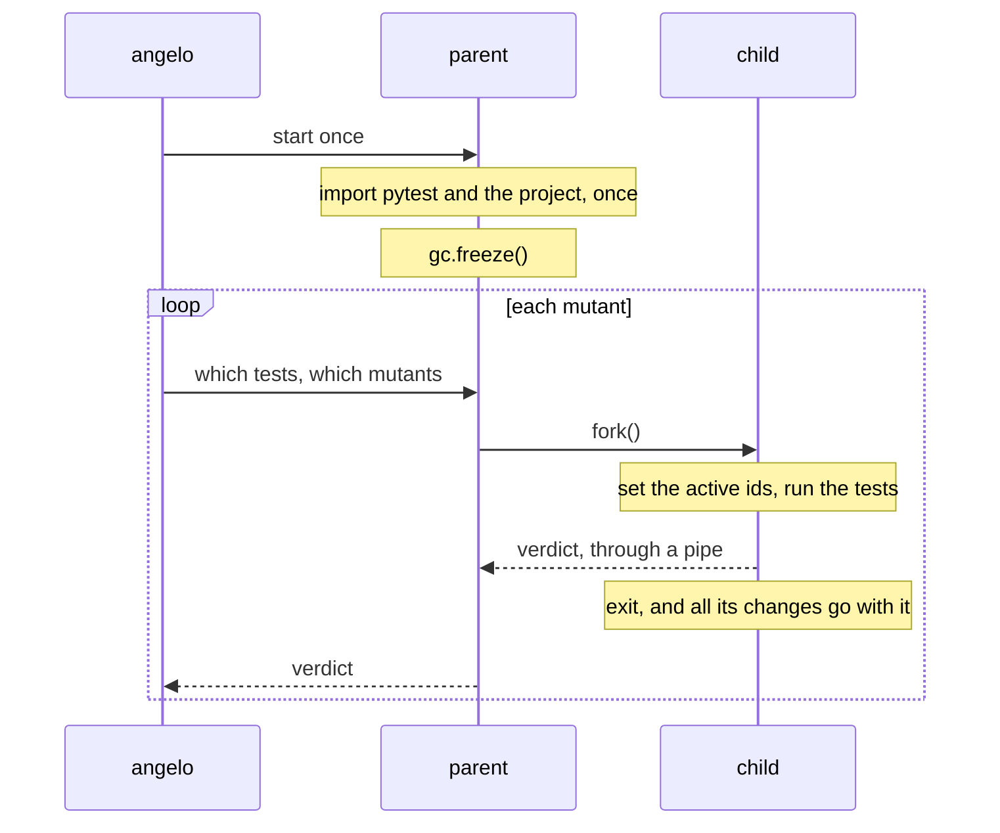

# Schemata

!!! abstract "Summary"
    A splice writes one mutant into a file. Thus the process must import the project again
    to see it. Schemata write **all** mutants into the file at once, and an environment
    variable selects one. Thus nothing is imported again. Only `fork()` makes this safe.
    Thus schemata apply only on Unix. Windows continues to use splices.

## The problem

[Warm workers](03-warm-workers.md) keep pytest imported. Between mutants, they remove the
modules of the project, so Python imports the changed source again. This import is the last
cost for each mutant, and it increases with the size of the project.

Measured in a forked child, with one test in each case:

| Project | Import again for each mutant | Keep the imports | Cost |
| --- | --- | --- | --- |
| 2 modules | — | — | 1 ms (1.05x) |
| 63 modules | 48.1 ms | 17.3 ms | **31 ms (2.76x)** |

On [`demo/`](https://github.com/kvandeh/angelo/tree/main/demo), this gives no improvement.
On a real package, it is most of the cost of a run.

## What mutmut does

Schemata make mutmut fast, not `fork()`. mutmut writes the syntax tree once into a
`mutants/` directory. Each function becomes a family of copies. `MUTANT_UNDER_TEST` selects
one copy for each run. `fork()` makes it safe to use the process again, because nothing is
imported again to reset it.

We measured fork **without** schemata first. It is not useful: it is approximately 2x
slower than the module removal. Each child must do the pytest session setup again. A
process that stays alive does this setup only once.

## Method

One function becomes four parts: its original, one copy for each mutant, a lookup table,
and a wrapper.

```python
def add__angelo_orig(a, b):
    return a + b

def add__angelo_7(a, b):
    return a - b

add__angelo_mutants = {7: add__angelo_7}

def add(*args, _angelo_orig=add__angelo_orig, _angelo_mutants=add__angelo_mutants,
        _angelo_cache=[-1, None], **kwargs):
    return _angelo_pick(_angelo_orig, _angelo_mutants, _angelo_cache)(*args, **kwargs)
```

Angelo makes the copies **as text**. Thus a mutant at any position in the function is in
the copy, and nothing must understand it: nested functions and comprehensions also.

Three details are necessary:

**The original and the table are default arguments.** The body of a method cannot see its
own class body. Thus a plain name would fail when Python calls it.

**`_angelo_cache` is a mutable default, on purpose.** Each function has one list. The
runtime finds the active mutant once for each batch and stores it in the list. Without
this, each call of each mutated function would search the full batch. That would make the
user's most-used code slower for the full run, not only for the mutant under test.

**Decorators go on the wrapper.** `@property` and `@classmethod` must wrap the function
that other code calls, not a copy of it.

## What stays as a splice

In one batch, all members must use schemata, or none. One spliced member makes Angelo write
the file and import it again. Thus Angelo makes batches from hosted mutants and spliced
mutants **separately**. If it mixed them, and two of three mutants were hosted, a batch of
eight would have only hosted mutants approximately one time in forty. Then the feature
would do nothing.

Angelo uses a splice for a mutant in these cases:

| Case | Reason |
| --- | --- |
| Module level, class attributes | There is no function to copy. |
| A mutant that does not parse | See below. |
| Function signatures | A default argument runs during import, not during a call. |
| `@x.setter` and similar | The decorator names the function that it changes. |
| Async generators | `async def` and `yield from` do not work together. |
| Windows | There is no `fork()`, so there is no isolation. |

**The most important case is a mutant that breaks the syntax.** As a splice, `*args`
changed to `/args` gives one `error` verdict, which is not in the score. Compiled into the
file, it breaks all other mutants in the file, and the full package. We found this on
flask, where all 221 mutants of a run became errors. This looks exactly like a broken test
command. Now Angelo parses each generated copy before it uses it.

## Result

flask, a sample of 1000 mutants, 16 workers, one mutant for each run. The same mutants were
judged two times:

| | Total time |
| --- | --- |
| Spliced | 158.4 s |
| Hosted | **115.9 s** |

**42.5 s, or 27%.** For each hosted mutant, the mechanism saves 115 ms: an import of the
210 flask modules takes 165.9 ms, and to keep them takes 50.5 ms. 467 of the 750 judged
mutants were hosted. This predicts 54 s. The difference comes from the file writes of the
splice path and from the mutants that schemata cannot host.

Ten of the 1000 verdicts are different. In five of them, **schemata correct the splice
path**: a mutant that was `error` as a splice was `killed` or `survived` when hosted.

!!! warning "Test selection hid this result"
    The first measurement said that schemata gave no improvement. That was correct for a
    broken run. coverage.py names a test context with the `__name__` of the module. junit
    names it with the path of the file. On a project with no `tests/__init__.py`, **no
    context matched**. Each run executed the full suite, and the 115 ms of saved import was
    small compared with 7.8 s of unnecessary tests. The fix decreased the time for the same
    mutants from 718 s to 125 s, and made this result visible. See
    [test selection](02-test-selection.md).

## Isolation

With schemata, nothing is imported again. Thus nothing resets the process between mutants.
Isolation is therefore mandatory.



`gc.freeze()` is mandatory. The child gets tens of thousands of tracked objects from the
parent. When the garbage collector examines them, it writes to each copy-on-write page that
it touches. Without `gc.freeze()`, a fork costs more than it saves. With it, the child took
26 ms, against 40 ms for a run in the same process.

The results:

- **`warm_recycle_after` has no effect on this path.** A forking worker collects no state.
  A restart would only repeat the warm-up. The worker tells Angelo that it forks, and
  Angelo stops the count.
- **A mutant that hangs does not stop a worker.** The parent controls the time limit. It
  stops the process group of the child, then takes the next mutant.
- **A worker that cannot fork uses module removal**, also when the caller asked for fork.
  This is slower, but correct. It occurs when the warm-up leaves a thread, because
  `fork()` in a process with more than one thread is not defined.

## Limits

- **Only on Unix.** Windows has no `fork()`. Without it, schemata would keep state between
  mutants, and nothing would reset it. That is worse than the method that it replaces.
- **Introspection changes.** `inspect.signature` sees the wrapper. Async functions and
  generator functions get wrappers of the same type. Thus `iscoroutinefunction` still
  gives the correct answer. But Angelo does not host async generators.
- **A mutant that raises an exception during import would break its full file.** For this
  reason, Angelo does not host signatures. A mutant in the body cannot run until a call
  occurs.
- The generated code is only in the temporary copy of the worker. It never changes the
  project. To debug it, use `ANGELO_DUMP_SCHEMATA=<dir>` to keep a readable copy.
