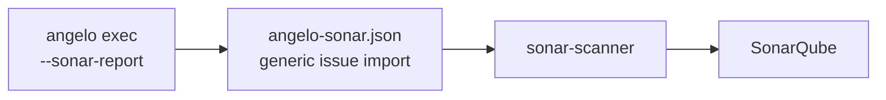

# SonarQube

!!! abstract "Summary"
    Many teams read their code quality in SonarQube. No other Python mutation testing tool
    sends survivors there. Angelo does. `--sonar-report` writes the generic issue import
    format of SonarQube, and `sonar.externalIssuesReportPaths` reads it. **No plugin, no
    Java, no installation on the server, and it works on SonarQube Cloud.** Tested on
    SonarQube 26.7 Community Build: the 28 survivors of the demo project became 28 issues,
    on the correct files and columns, with no warning.

## Background

SonarQube has three ways to receive data. We examined all three, so that nobody must
examine them again.

| Path | Mechanism | Verdict |
| --- | --- | --- |
| **Generic issue import** | `sonar.externalIssuesReportPaths` reads a JSON file of issues | **We use this.** No plugin, no Java. It works on Community Build and on Cloud. |
| **A SonarQube plugin** | A Java plugin that declares `Metrics`. This is the only way to get a real *metric*, with history and a quality-gate condition on the number. | **Built**, in `integrations/sonarqube/`. Only on a self-hosted server: SonarQube Cloud does not run third-party plugins. See [the plugin](10-sonar-plugin.md). |
| **Write Pitest `mutations.xml`** for the existing Mutation Analysis plugin | — | **Does not work** |

The third path looks easy, but it does not work. The plugin registers only
`JavaRulesDefinition` and `KotlinRulesDefinition`. Its rules activate only through Java and
Kotlin quality profiles, and a Python project never has these. Its parser reads
`sourceFile` as a Java file name with a `mutatedClass`. **Do not spend time on it.**

One correction is important, because it is easy to read incorrectly. In 8.2, SonarQube
deprecated the manual `api/custom_measures` web API. It did **not** deprecate the plugin
`Metrics` extension point. The plugin path is still available. It is only expensive.

## Method

Two steps. Angelo writes the file that SonarQube reads.



```bash
angelo exec --sonar-report angelo-sonar.json --fail-under 60

sonar-scanner -Dsonar.externalIssuesReportPaths=angelo-sonar.json
```

**You install nothing on the SonarQube server.** SonarQube makes the two rules of Angelo as
*external* rules, from the file alone. For this reason, the rules never show on the Rules
page or in a quality profile. See [Limits](#limits).

### The route that this replaces

The first design used the jq filter of Stryker. It changes the `--report` schema into the
same format:

```bash
angelo exec --report angelo.json
curl -sSLO https://raw.githubusercontent.com/stryker-mutator/mutation-testing-elements/master/integrations/mutation-report-to-sonar.jq
jq -f mutation-report-to-sonar.jq angelo.json > angelo-sonar.json
```

This works. A converter that a different team maintains looked like the better choice,
until we measured it. **SonarQube 26.7 imports the output of the filter, but it gives a
warning:**

```
WARN External issues were imported with a deprecated format which will be
removed in a later version of SonarQube. The "rules" field is missing.
```

The filter writes `engineId`, `type` and `severity` in each issue, and it writes no `rules`
array. That is the format from before version 10, and SonarQube will remove it.
`--sonar-report` writes the current format: a `rules` array that declares
`cleanCodeAttribute` and `impacts`. Thus there is no deprecation warning and no jq
dependency.

This page keeps the jq route, because it still works. A project that already writes
`--report` for the Stryker viewer can use it. But we recommend `--sonar-report`.

### Two rules

Only survivors become issues. There are two types, and they are **not** the same finding.

| Rule id in SonarQube | Angelo status | What the developer must do |
| --- | --- | --- |
| `external_Angelo:MutantSurvived` | `survived`, a test ran it | Add an assertion. A test executes this line but checks nothing about it. |
| `external_Angelo:MutantNoCoverage` | `survived`, no test ran it | Write a test. No test executes this line. |

Both rules have the clean-code attribute **`TESTED`**, the SonarQube term for exactly this.
Both have a `MAINTAINABILITY` impact: `MEDIUM` for a survivor and `HIGH` for an uncovered
mutant. `engineId` is `Angelo`, which gives the prefix `external_Angelo:`.

No other status becomes an issue. `killed` means that the suite works. `error` and
`untestable` are Angelo reports about itself. A splice that broke the syntax is not a
problem in the code of the user. **For this reason, use `--fail-under` as the gate, never
this file.** See [The caveat that matters](#the-caveat-that-matters).

### Four things that fail silently if they are wrong

Four fields are easy to get a little wrong. Each one fails *without an error*. Thus each one
has a unit test in
[`src/sonar.rs`](https://github.com/kvandeh/angelo/blob/main/Angelo/src/sonar.rs). The same
four have tests in
[`src/stryker.rs`](https://github.com/kvandeh/angelo/blob/main/Angelo/src/stryker.rs) for
the jq route.

| Requirement | Reason | Failure |
| --- | --- | --- |
| Paths are **relative and use forward slashes** | SonarQube compares `filePath` exactly with paths under the base directory of the scanner | A Windows separator matches no file, and SonarQube **ignores the issue with no error** |
| Columns are **0-based** for SonarQube, and 1-based in the schema | The two formats are different. Thus each column decreases by one. | The mark is on the wrong token |
| `NoCoverage` is separate from `Survived` | Different rule, different action | "Write a test" and "add an assertion" become one finding |
| A `rules` array with `cleanCodeAttribute` and `impacts` | The old `type`/`severity` pair in each issue is deprecated | The import gives a warning, and a later SonarQube will reject it |

## In CI

```yaml
- name: Mutation testing
  run: angelo exec --diff-base --sonar-report angelo-sonar.json --fail-under 60

- name: SonarQube scan
  if: always()
  uses: SonarSource/sonarqube-scan-action@v6
  env:
    SONAR_TOKEN: ${{ secrets.SONAR_TOKEN }}
  with:
    args: -Dsonar.externalIssuesReportPaths=angelo-sonar.json
```

The scan step needs `if: always()`. When the score is low, `--fail-under` exits with code 1.
That is the time when the issues are most important.

**`--diff-base` works well with this.** It limits the run to the lines that the branch
adds. These are the same lines that the SonarQube "new code" period examines.

## Configuration

You can put the flag in `angelo.conf`. The flag has priority over the file.

```toml
sonar_report = "angelo-sonar.json"   # empty means off, which is the default
```

## Result

We tested the full route on **SonarQube 26.7.0 Community Build** with the `demo/` project:
74 mutants, a score of 62.2%, scanned from a Windows computer.

| Check | jq route | `--sonar-report` |
| --- | --- | --- |
| Issues imported | 28, the same as the 28 survivors of the run | **28** |
| Split by rule | 19 `MutantSurvived`, 9 `MutantNoCoverage` | **The same** |
| Files found | All three, by relative path | **All three** |
| Column accuracy | `calculator.py:51` columns 13–15 are `>=`, columns 16–19 are `100` | **The same** |
| Scanner format warning | **Deprecated format, `rules` field missing** | **None** |

The two routes give the same issues. `--sonar-report` gives them in the format that
SonarQube will keep.

The same scan also imported a coverage report:

| Metric | Value |
| --- | --- |
| Line coverage | 89.6% |
| Mutation score | 62.2% |

**This difference is the reason for the tool.** Coverage tells you that the line ran. The
mutation score tells you that a test checked its behaviour.

## The caveat that matters

**A run where all mutants are `error` exports an empty issue list. SonarQube shows this as
"no problems".**

Only survivors become issues. A broken test command gives only `error`, thus zero
survivors, thus a green dashboard. This is the characteristic failure of this tool in the
opposite direction. It is worse here, because the error-count warning of Angelo never goes
to SonarQube.

Two things prevent this. Both are necessary:

1. **Always use `--sonar-report` with `--fail-under`, never as a replacement.** The exit
   code stops a broken run. The report only shows information.
2. Also write `--html-report` or `--report`, for the full result. SonarQube shows only
   survivors. Those two files show the `error` and `untestable` counts. The
   [HTML report](07-reports.md) shows them above the score, where you cannot miss them.

## Limits

- **This route sends no mutation score to SonarQube.** The generic import makes *issues*. A
  percentage is a *measure*. There is no import for measures (`api/custom_measures` was
  removed in 8.2). Thus the score needs [the plugin](10-sonar-plugin.md), which works only
  on a self-hosted server. On Cloud, the score stays in the terminal, the exit code and the
  HTML report.
- **Quality profiles cannot control external issues.** They do not show on the Rules page.
  You cannot mark them as false positives in SonarQube. You cannot remove them from a
  generic "new issues > 0" gate. A team that wants to see them, but not be blocked by them,
  has no setting for this.
- **The jq route needs jq.** GitHub-hosted runners have it. On Windows, you must install it
  for a local scan. `--sonar-report` needs only Angelo.
- **Coverage is a separate import.** SonarQube runs no tests. Line coverage stays 0% until
  `sonar.python.coverage.reportPaths` points to a `coverage.xml`. `sonar.tests` only marks
  files as test code. It imports no coverage.
- `sonar-stryker-plugin` reads StrykerJS `event-recorder` streams, not the JSON report.
  Thus it is not a shortcut either.
