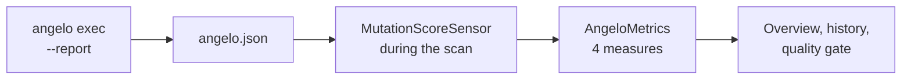

# The SonarQube plugin

!!! abstract "Summary"
    [`--sonar-report`](09-sonarqube.md) shows survivors in SonarQube as issues. It cannot
    send the score, because the import makes issues and a percentage is a measure. This
    plugin adds the score. It is a jar that declares **Mutation Score** as a real SonarQube
    metric, with history and a quality-gate condition on the number. It has approximately
    280 lines of Java. It does not change Angelo. It **cannot run on SonarQube Cloud**.

## Background

SonarQube has two types of data that look similar on a dashboard.

| | Made by | Angelo sends it with |
| --- | --- | --- |
| An **issue** | Generic import, SARIF, or an analyzer | `--sonar-report`, no plugin |
| A **measure** | An analyzer that declares `Metrics`, that is, a plugin | This jar |

There is no import for measures. `api/custom_measures` was the only one, and SonarQube
**removed it in 8.2**. All the remaining `api/measures/*` and `api/metrics/*` endpoints are
read-only. Thus a mutation score on the dashboard needs a plugin.

In 8.2, SonarQube deprecated that web API. It did **not** deprecate the plugin `Metrics`
extension point. This difference is the reason for this page.

## Method

The plugin uses three extension points. It does nothing unusual.



| Class | Function |
| --- | --- |
| `AngeloPlugin` | Registers the other two classes |
| `AngeloMetrics` | Declares the four metrics in a **Mutation Testing** domain |
| `MutationScoreSensor` | Reads `angelo.json` during the scan and saves the measures |

The sensor reads the **mutation-testing-report schema** that `--report` writes. StrykerJS and
Stryker.NET also write this schema. Thus the plugin is not specific to Angelo. The sensor
uses the calculation of the schema, `detected / valid`, which is exactly `Summary::score`.
**Nothing calculates a second score that could be different.**

### The metrics

| Key | Name on screen | Value |
| --- | --- | --- |
| `angelo_mutation_score` | Mutation Score | `detected / valid` as a percentage |
| `angelo_mutants_valid` | Mutants Scored | The denominator. Thus you always see the sample size with the score. |
| `angelo_mutants_survived` | Mutants Survived | Mutants that no test detected |
| `angelo_mutants_errored` | Mutants Errored | Mutants that no run could judge |

**The plugin publishes `angelo_mutants_errored` on purpose.** A run where all mutants are
`error` has no score. A score of 0% would look like a very bad suite, not like a broken test
command. Thus in this case, the sensor publishes no score and writes a message in the scan
log. The error count must be next to it.

## Install it

The jar is on its own GitHub release. It has its own version tag, because it follows the
SonarQube API, not the features of Angelo.

```bash
# Download sonar-angelo-plugin-<version>.jar from the releases page, then:
docker cp sonar-angelo-plugin-0.1.0.jar sonarqube:/opt/sonarqube/extensions/plugins/
docker restart sonarqube
```

For a server without a container, put the jar in `extensions/plugins/` and restart the
server. Make sure that it loaded:

```bash
curl -s -u admin:admin http://localhost:9000/api/plugins/installed | grep angelo
```

Then write a report and scan as usual:

```bash
angelo exec --report angelo.json --sonar-report angelo-sonar.json
sonar-scanner -Dsonar.externalIssuesReportPaths=angelo-sonar.json
```

`sonar.angelo.reportPath` changes the location where the sensor looks. The default is
`angelo.json`, relative to the base directory of the scanner. If the file is missing, the
sensor writes a log message and continues. This is never an error, because the mutation
score is extra information. It is not the reason for the scan.

## Use it as a gate

**Quality Gates → your gate → Add condition → Mutation Score → is less than → 80.** Then
select the gate in **Project Settings → Quality Gate**. A failed gate shows on the project
overview, and it makes the scanner step fail in CI.

## Result

Tested on **SonarQube 26.7.0 Community Build**, with a scan of the `demo/` project from a
Windows computer.

| Check | Result |
| --- | --- |
| The plugin loads | Yes, `"key":"angelo"` in `api/plugins/installed` |
| Score published | **62.16%**, exactly the same as the terminal output of Angelo |
| Counts published | 74 scored, 28 survived, 0 errored |
| Quality-gate condition | `angelo_mutation_score < 80` accepted, result **ERROR** |
| Line coverage | 89.6%, not changed |

The build workflow does the load check again on each push. It starts a real SonarQube with
the new jar. If `api/plugins/installed` does not show the plugin, the workflow fails. **The
characteristic failure here is a plugin that compiles but does not load.** `mvn package`
cannot detect it. Only the server checks the API version, the manifest entries and the
bytecode level, when it starts.

## Limits

- **SonarQube Cloud runs no third-party plugins.** This is not a configuration problem, and
  a later version of this jar cannot fix it. Cloud users get `--sonar-report` and no score.
  This is the most important fact on this page.
- **The gate applies only to Overall Code.** A new-code condition needs a separate metric
  with the prefix `new_`, calculated over the new-code period by a `MeasureComputer`. This
  jar declares no such metric. Thus *"new code must score 80%"* is not available. On a large
  repository, the score of the full project changes very little, so it is a weak gate. This
  is the most useful thing to build next, together with `angelo exec --diff-base`.
- **The score is for the project, not for each file.** The sensor saves the measures on the
  project. Thus no file has its own mutation score. The [HTML report](07-reports.md) sorts
  the files, worst first.
- **It is not on the Marketplace.** A Marketplace listing needs a review by SonarSource.
  Thus you must install the jar yourself.
- **Compiled against `sonar-plugin-api` 10.11, tested on 26.7 Community Build.** We did not
  test older servers. We do not know of a problem with them.
