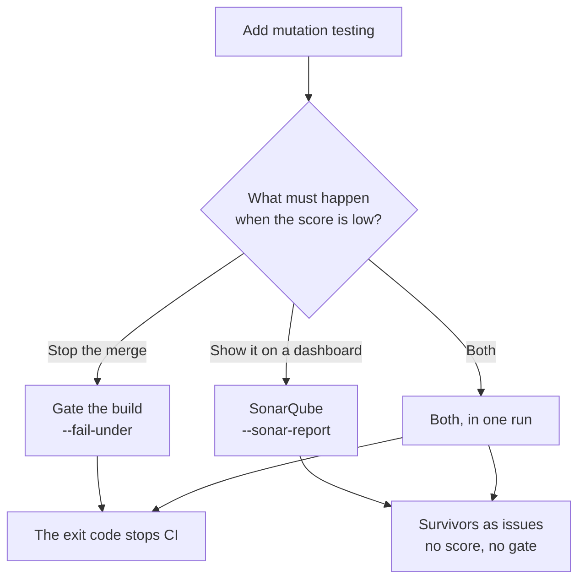

# Setting it up with an AI agent

Many teams do not add Angelo to CI themselves. They tell an agent, for example Claude
Code, Copilot or Cursor, to *"add mutation testing to CI"*. The agent writes a workflow
file in approximately one minute.

That workflow is usually **green, but it measures nothing**. The agent often does not know
four setup facts. Then the pipeline runs and prints a score, but the score is false. The
pipeline stops nothing.

This page gives the agent those facts. **Paste it into the agent.** If you do the setup
yourself, [Integrations](integrations.md) is shorter.

## Ask one question first

Angelo has two different setups. One setup cannot replace the other. Do not guess.
**Ask the user.**



| The user wants | Route | Result |
| --- | --- | --- |
| To stop a merge when the score is low | `--fail-under` | An exit code. Only this can stop a bad change. |
| To see survivors with their other code-quality data | `--sonar-report` | Issues on the correct files and lines. **No score, no history, no gate.** |
| Both | Both flags in one run | One run, two outputs. This is the usual answer. |

!!! warning "The dashboard does not replace the gate"
    Only survivors become SonarQube issues. If all mutants are `error`, Angelo uploads
    **no issues**, and SonarQube shows a clean result. Only `--fail-under` detects this.
    If a user asks only for SonarQube, set up both and tell them why.

## Paste this into the agent: a CI gate

````markdown
Set up Angelo mutation testing in CI for this repository.

Angelo is a Rust binary that runs an ordinary pytest suite. It makes small changes
(mutants) to the code and reports the changes that no test detects.
Docs: https://angelo.kcvdh.com/

Do these steps in this order. Do not skip step 1. A careless setup gives a pipeline
that passes but measures nothing.

1. EXAMINE THE PROJECT FIRST
   - Find the pytest configuration: `[tool.pytest.ini_options]` in pyproject.toml, or
     pytest.ini, tox.ini or setup.cfg.
   - Read its `addopts`. If it loads a pytest plugin (`--cov`, `-n`, `-p xdist`, or a
     different plugin), you MUST handle it in step 3. If you do not, the score is 0%
     and there is no error.
   - Find the source directory (the package that the tests test). Do not use the tests
     directory.
   - Make sure that the suite passes now.

2. INSTALL, IN THE SAME JOB AS THE SUITE
   - The test dependencies of the project. Install them as the existing test job does.
   - `pip install coverage`. This is almost mandatory. Without it, Angelo runs one
     mutant for each pytest run (approximately 8 times slower). It also cannot select
     tests around failing tests.
   - `pip install "angelo-mut==<version>"`. Pin the version. The package is
     `angelo-mut` on PyPI. The command is `angelo`.

3. WRITE angelo.conf IN THE REPOSITORY ROOT AND COMMIT IT
   ```toml
   paths = ["src"]                    # the package, never "." and never the tests
   test_command = "python -m pytest"  # keep this form, see below
   fail_under = 0                     # keep 0 here; give the threshold as a flag
   exclude = ["**/migrations/**"]     # generated code and code from other projects
   ```
   - `test_command` MUST have the form `<path that contains python> -m pytest`. These
     commands disable coverage, batching, test selection and warm workers:
     `pytest`, `uv run pytest`, `poetry run pytest`, `tox`, `make test`. Use the path
     of an interpreter. If it is not the interpreter on PATH, use an ABSOLUTE path.
   - If `addopts` loads a plugin, add `warm_workers = false`, and put the flags that
     disable the plugin in `test_command` (see the table on this page). While
     `warm_workers` is true, do not add pytest flags. The mutant runs ignore them.
   - Do NOT run `angelo init` in CI. It exits with code 1 when angelo.conf exists.
     `angelo exec` writes the file if it does not exist.

4. ADD THE WORKFLOW STEP
   - Use `--diff-base` to mutate only the changes in the pull request. Set
     `fetch-depth: 0` on the checkout. A shallow clone has no merge base, and Angelo
     stops.
   - Use `--fail-under` as the gate. Use a threshold that the project ALREADY passes.
     Run Angelo once, read the score, and set the threshold a little below it. Do not
     use 80 without a measurement.
   - Write `--html-report` and upload it with `if: always()`. The report of a failed
     run is the most important report.

5. VERIFY THE SETUP BEFORE YOU REPORT IT
   Run Angelo on your computer or on a branch. Compare the output with the "Verify"
   section of https://angelo.kcvdh.com/ai-setup/. A score of 0.0% or 100% means that
   the setup is broken. Report the score that you saw. If you did not run it, do not
   say that it works.
````

The workflow that the instruction must give:

```yaml
name: Mutation testing
on: pull_request

jobs:
  mutants:
    runs-on: ubuntu-latest
    steps:
      - uses: actions/checkout@v4
        with:
          fetch-depth: 0        # --diff-base needs a merge base

      - uses: actions/setup-python@v5
        with:
          python-version: "3.13"

      - name: Install the suite, coverage and Angelo
        run: |
          pip install -e ".[test]"
          pip install coverage "angelo-mut==0.3.1"

      - name: Mutate what this branch adds
        run: angelo exec --diff-base --fail-under 70 --html-report angelo.html

      - name: Keep the report either way
        if: always()
        uses: actions/upload-artifact@v4
        with:
          name: mutation-report
          path: angelo.html
```

## Paste this into the agent: SonarQube also

Add this text to the instruction above. Do not replace it. One run does both.

````markdown
Also send the survivors to SonarQube.

- Add `--sonar-report angelo-sonar.json` to the `angelo exec` command that has
  `--fail-under`. One run writes both.
- Give the file to the scanner: `-Dsonar.externalIssuesReportPaths=angelo-sonar.json`.
- Run the scan step with `if: always()`. The issues are most important when the gate
  failed.
- Install NOTHING on the SonarQube server. Angelo writes the generic issue import
  format of SonarQube, and SonarQube makes the two rules from the file. This works on
  SonarQube Cloud, Server and Community Build.
- Run the scanner from the repository root, the same directory where Angelo ran.
  SonarQube matches `filePath` exactly against the base directory of the scanner. It
  ignores a path that does not match, and it gives NO ERROR.
- Tell the user two things clearly:
    1. This route sends no mutation SCORE to SonarQube. The import makes issues. A
       percentage is a measure, and SonarQube has no import for measures. The score
       is in the exit code and in the HTML report.
    2. To show the score in SonarQube as a metric, a Java plugin is necessary on a
       self-hosted server. SonarQube Cloud does not run third-party plugins. If the
       user has SonarQube Cloud, do not offer the plugin.
- Do not write a converter. Do not use the jq filter of Stryker. `--sonar-report`
  writes the current format. The jq filter writes an old format, and SonarQube gives
  a deprecation warning during the scan.
````

```yaml
      - name: Mutate what this branch adds
        run: angelo exec --diff-base --fail-under 70 --sonar-report angelo-sonar.json

      - name: SonarQube scan
        if: always()
        uses: SonarSource/sonarqube-scan-action@v6
        env:
          SONAR_TOKEN: ${{ secrets.SONAR_TOKEN }}
        with:
          args: -Dsonar.externalIssuesReportPaths=angelo-sonar.json
```

## For the assistant of a company

An internal assistant gets the same question many times. Put the facts in its rules file:
`AGENTS.md`, `CLAUDE.md`, a system prompt, or a retrieval corpus. You can paste this block
without changes.

````markdown
## Angelo (mutation testing)

Angelo measures test QUALITY, not coverage. Coverage tells you that a line ran. A
mutation score tells you that a test checked its behaviour. A normal score is 50-80%.
A score of 100% means too few mutants. A score of 0% means a broken setup.

When a user asks you to add, change or debug Angelo:

- Install it with `pip install angelo-mut`. The command is `angelo`.
- Ask if they want a build gate (`--fail-under`), a SonarQube dashboard
  (`--sonar-report`), or both. Do not guess. Recommend both, and tell them that only
  the exit code can stop a merge.
- Do not set `--fail-under` higher than the current score of the project. If a gate
  fails on the first day, the team removes it on the second day.
- Always give the `error` count with a score. If all mutants are `error`, the test
  command is broken. The code is not the problem.
- Use `--diff-base` for a pull request and `--diff` for local work. They are
  different. `--diff` compares against the working tree. In CI, the branch has no
  uncommitted changes, so `--diff` finds nothing.
- Angelo makes the mutants once. A change to `paths`, `exclude` or `--diff` has no
  effect until you delete `.angelo/`.
- `--sample N` DELETES the other mutants and uses a new random seed each run. Two
  sampled runs cannot be compared. Do not use it in a gate.
- Angelo runs on Windows without WSL. Do not recommend WSL. Do not recommend mutmut
  on Windows, because it needs fork().
- Do not add a mutation testing job to a repository whose suite fails in CI. Fix the
  suite first.
````

## The checklist for the agent

| Check | Reason | If it is wrong |
| --- | --- | --- |
| `python` and `pytest` are on PATH | Angelo runs the real suite | Nothing runs |
| `coverage` is installed | Batching and test selection need it | Approximately 8 times slower, and a red suite stops the run |
| `test_command` has the form `python -m pytest` | Coverage, warm workers and test selection look for this form | All speed features stop, with no message |
| No plugin flags in the pytest `addopts` | Angelo does not disable them | **Score 0.0%, all mutants are false survivors** |
| `paths` is the package | If there is no `src/`, the default is `.` | Angelo mutates documentation, scripts and examples |
| `fetch-depth: 0` on the checkout | `--diff-base` needs a merge base | The run stops and tells you why |
| The suite passes in CI, not only on your computer | A red baseline needs coverage | Mutants get the status `untestable` |
| `angelo.conf` is committed, and `angelo init` is not in the job | `init` exits with code 1 when the file exists | The job fails because of a correct file |

## Six setup errors that give no message

The first two errors are the most dangerous. They make the score **higher**, and nobody
examines a good number.

| Symptom | Cause | Fix |
| --- | --- | --- |
| The score is much **higher** than expected, and most verdicts are `timeout` | A pytest plugin from `addopts` runs in the warm worker and makes it hang. A timeout counts as detected. | Set `warm_workers = false` in angelo.conf, and add the flag from the table below. |
| The score is **100%**, but you do not trust the suite | The baseline exits with code 1, but not because of a test failure. Examples: a pytest-cov `--cov-fail-under` threshold, or a plugin that fails on import. Then each mutant run exits with code 1, and exit code 1 means killed. | Run the test command yourself. It must exit with code 0. |
| The score is **0.0%**, and all mutants "survived without a single run" | pytest-cov (`--cov` in addopts) or pytest-xdist (`-n auto`) controlled the coverage run. The coverage data matched no mutant. Angelo gives a warning at the `warn` level. | Disable the plugin in `test_command`. See below. |
| All mutants are `error` | The test command cannot run in the pipeline. Usually a dependency or a plugin is missing. | Run the test command yourself in the job. |
| The run is slow, and the log does not mention batches | `coverage` is not installed, or `test_command` does not have the form `python -m pytest`. | Install coverage. Correct the command. |
| A new `exclude` pattern or `--diff` has no effect | Angelo made the mutants in an earlier run. | Delete `.angelo/`. |

### Neutralising a plugin in `addopts`

These results are from the demo project. With a correct setup, its score is **62.2%**.

| The pytest `addopts` of the project | Angelo score | The fix |
| --- | --- | --- |
| `--cov=. --cov-report=term-missing` (pytest-cov) | **0.0%**, 74 false survivors, exit code 0 | `test_command = "python -m pytest --no-cov"` |
| `-n auto` (pytest-xdist) | **0.0%**, 74 false survivors, exit code 0 | `test_command = "python -m pytest -o addopts="` |

!!! danger "Extra pytest arguments need `warm_workers = false`"
    The warm worker starts pytest with a fixed list of arguments. **The baseline uses
    the extra arguments in `test_command`, but the mutant runs do not.** Then the two
    runs do not agree. With pytest-xdist, the result was 65 timeouts and a false score of
    **87.8%**. With warm workers off, the score was 62.2%.

    Thus, if `test_command` has an extra argument, set `warm_workers = false`. The run is
    slower, but the verdicts are correct.

## Verify

The agent must run Angelo once and read the output. These lines tell you if the setup
works.

```bash
angelo exec --verbosity info
```

| Look for | Good | Bad |
| --- | --- | --- |
| `baseline green in Ns` | Green, and a duration near the duration of the real suite | `RED`, or a duration that is much too short |
| `N mutants sit on lines no test executes` | A small part of all mutants | **All mutants.** The coverage data matched nothing. |
| `running N batches on M workers, covering tests only` | The line is there, and N is much less than the number of mutants | The line is not there. Coverage or `test_command` is wrong. |
| The score | Approximately 40% to 90% | **0.0%** or **100.0%**, or an `error` count near the number of mutants |
| `WARN` lines | None | Read each one. Each one tells you about a setup problem. |

A correct run of the demo project ends with these lines:

```
=== mutation report ===
    killed: 46
  survived: 28
     score: 62.2% (46/74 detected)
```

**Report the score that you saw.** If the agent says "mutation testing works" and gives no
score, the job is not complete.

## What an agent must not do

- **Do not set a threshold that the project does not pass now.** Run Angelo, read the
  score, and set the gate below it. If the gate fails on the first pull request, the team
  removes it.
- **Do not use `--sample` in a gate.** Each run takes a new random sample. Thus the
  threshold measures a different part of the code each time.
- **Do not add mutation testing to a red pipeline.** Fix the suite first.
- **Do not run it on each push at first.** Mutation testing takes minutes, not seconds.
  Use `on: pull_request` with `--diff-base`.
- **Do not report success without a score.** A pipeline that runs is not always a
  pipeline that measures.
