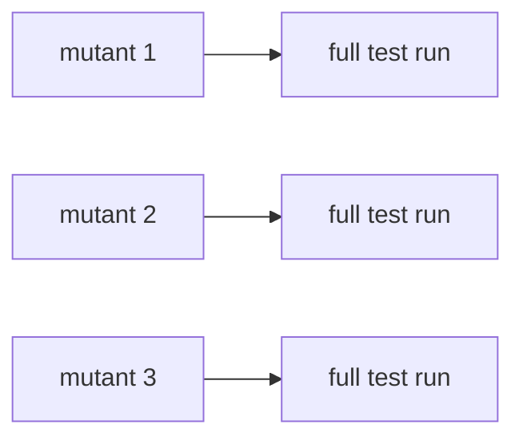
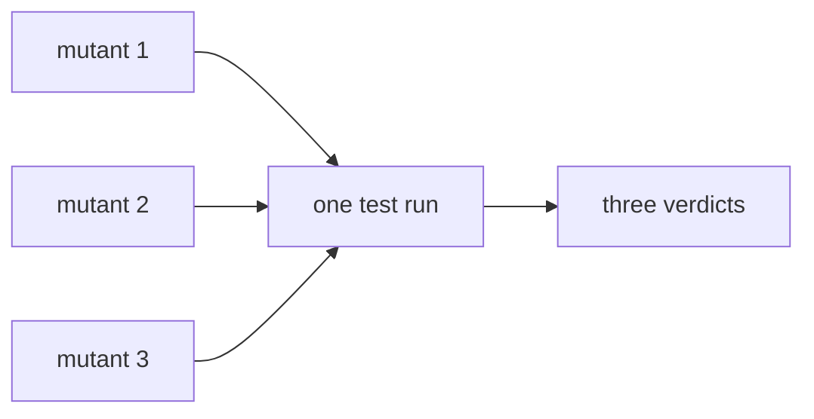

# Angelo

> Fast mutation testing for Python.

Angelo measures the quality of your tests. It makes small changes to your code on purpose.
Then it runs your pytest suite and finds the changes that no test detected. Angelo is one
Rust binary. It uses your existing pytest suite.

On a project with 200 mutants and a 2-second suite, Angelo takes **4.5 seconds**. The
standard method takes **48 seconds**. The score is the same.

[Run it on your computer](quick-start.md){ .md-button .md-button--primary }
[Connect it to other tools](integrations.md){ .md-button }

```bash
pip install angelo-mut
```

You need two commands and an existing pytest suite. You do not have to configure anything
to start. [We measured all numbers on this site](05-benchmarks.md).

| You want to | Go to |
| --- | --- |
| Run Angelo on a project | [Run it locally](quick-start.md) |
| Check a pull request, or put a score in CI | [Integrations](integrations.md) |
| Show survivors in SonarQube | [Integrations](integrations.md#sonarqube) |
| Let an AI agent do the setup | [Setting it up with an AI agent](ai-setup.md) |
| Examine the speed measurements | [Benchmarks](05-benchmarks.md) |
| Learn about mutation testing first | Continue on this page |

## What mutation testing measures

Coverage tells you that a line ran. It does not tell you that a test checked the result.
A suite can execute all lines of a function and still pass when the function is wrong.

Mutation testing makes the code wrong on purpose. Then it runs the tests:

| Term | Meaning |
| --- | --- |
| **Mutant** | One small deliberate change, for example `+` to `-` |
| **Killed** | A test failed. Your suite detected the bug. |
| **Survived** | All tests passed. Your suite did not detect the bug. |
| **Timeout** | The mutant did not stop. This counts as detected. |
| **Score** | (killed + timeout) / (killed + timeout + survived) |

A survivor is the useful result. It shows a line where you can break the behaviour and no
test fails.

```python
def is_adult(age):
    return age >= 18
```

Change `>=` to `>`. The function now rejects people who are 18. If your tests still pass,
no test checks the boundary. Angelo tells you this.

## Why mutation testing is usually slow

The standard method runs the full suite once for each mutant. 500 mutants need 500 runs.
Also, most of each run is not test time. These are the times for one selected test:

| Step | Time |
| --- | --- |
| Start the interpreter | 18 ms |
| Import pytest | 155 ms |
| Collect and configure | 139 ms |
| Run the test | 15 ms |

Approximately 95% of the time is setup. Angelo decreases this time.

## How Angelo is fast

Angelo uses four techniques. We measured each technique, and each has its own page.

| Technique | Idea | Speed-up |
| --- | --- | --- |
| [Batch mutating](01-batch-mutating.md) | Test some mutants in one run | 4.6x |
| [Test selection](02-test-selection.md) | Run only the tests that reach the mutant | 2.8x |
| [Warm workers](03-warm-workers.md) | Keep one pytest process alive | 2.5x |
| [A smaller pool](06-operators-and-sampling.md) | Make only the mutants that research supports, and only where they are useful | varies |

`--diff` and `--diff-base` also decrease the work. They mutate only the lines that a change
touched. See [Run it locally](quick-start.md#make-the-run-smaller).

!!! warning "These numbers are a best case"
    They come from a synthetic project with independent functions and no timeouts. On the
    real click codebase, approximately 7% of mutants hang until the timeout. There, the
    same techniques gave
    [almost no improvement](05-benchmarks.md#a-real-codebase-where-the-numbers-do-not-hold).
    The wait for timeouts is more than the time that they save.

### Batching in one picture

Batching is the most important technique.

Usually, each mutant gets its own run:



Angelo puts some mutants into the same run:



This causes a problem. If the run fails, which mutant caused the failure? Angelo puts two
mutants in one run only when **no test reaches both**. Before it makes any mutant, Angelo
runs the suite once with coverage. This tells it which tests reach which lines. Thus a
failed test identifies exactly one mutant.

A batch can kill mutants. It cannot make a mutant survive. Angelo runs each possible
survivor again, alone. [Read the full explanation](01-batch-mutating.md).

## The rule everything obeys

Batching, test selection and warm workers make a run faster. **They must not change a
verdict.**

`scripts/verdict-matrix.sh` enforces this rule. It runs the same project in all
combinations of these features: 16 configurations on Linux and macOS, 8 on Windows. If two
configurations give different scores, the build fails. CI runs it on each pull request.

## Where to go next

- **New?** [Run it locally](quick-start.md) installs Angelo and explains your first
  report.
- **Automation?** [Integrations](integrations.md) is about CI, pull requests, SonarQube
  and PyPI.
- **Evidence?** [Benchmarks](05-benchmarks.md) has all the measurements, also the bad
  results.
- **Design?** [Architecture](04-architecture.md).
- **Help?** [Support](support.md), or read
  [CONTRIBUTING.md](https://github.com/kvandeh/angelo/blob/main/CONTRIBUTING.md).

---

Run Angelo on a project that you have, and see what your tests do not detect.

[Run it on your computer](quick-start.md){ .md-button .md-button--primary }
